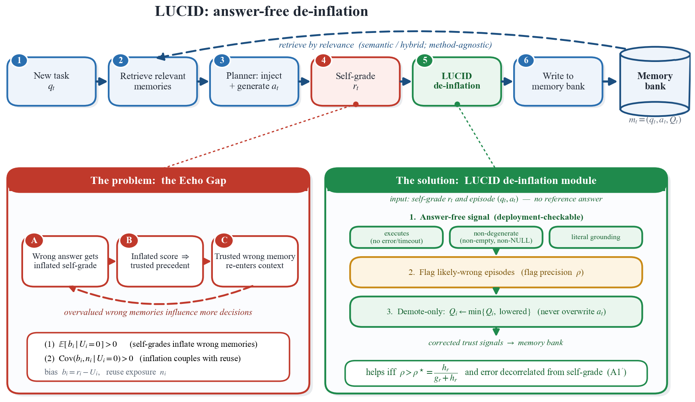

<h1 align="center">Memory Reward Inflation in Self-Improving LLM Agents</h1>

<p align="center">
  <b>Mohammad Asadolahi</b><sup>1</sup> &nbsp;·&nbsp;
  <b>Amir Amini</b><sup>2</sup> &nbsp;·&nbsp;
  <b>Samira Talebi</b><sup>3</sup> &nbsp;·&nbsp;
  <b>Amirfarhad Farhadi</b><sup>4</sup> &nbsp;·&nbsp;
  <b>Azadeh Zamanifar</b><sup>5</sup>
</p>

<p align="center">
  
  
  
</p>

<p align="center">
  <a href="#abstract">Abstract</a> &nbsp;|&nbsp;
  <a href="#getting-started">Getting started</a> &nbsp;|&nbsp;
  <a href="#running-the-experiments">Running the experiments</a> &nbsp;|&nbsp;
  <a href="#repository-structure">Repository structure</a> &nbsp;|&nbsp;
  <a href="#data-availability">Data availability</a> &nbsp;|&nbsp;
</p>

<p align="center">
  
</p>

<p align="center">
  <em>Conceptual mechanism of the Echo Gap in self-improving memory agents, and LUCID, which demotes
  inflated past experiences.</em>
</p>

## Abstract

<p align="justify">
Self-improving large language model (LLM) agents increasingly learn from experience without updating
any weights. Each episode is stored in an external memory, scored, and retrieved to guide similar
future tasks. The stored score thus acts as a proxy reward for an implicit, non-parametric policy
whose reliability hinges on how that score is produced. In deployment, ground-truth labels are
unavailable, so the stored reward is at best an LLM assessment. This substitution creates a failure
mode, the <em>Echo Gap</em>, across the agents and model families studied: incorrect episodes receive
inflated rewards, and the agent preferentially reuses the very mistakes in which it is most
confident. We show that the inflation compounds through memory rather than averaging out, even under
similarity-only retrieval, the regime of the memory agent. A re-grading LLM judge cannot identify
which memories are overvalued, because its errors remain correlated with the original self-grading
bias. The missing property is formalized as the <em>Error-Independence Criterion</em> (EIC), which we
prove is a <em>necessary</em> condition for correcting the inflation within the class of linear
de-inflation rules, not merely a description of a good verifier: a usable signal must track truth
<em>and</em> decorrelate its error from the memory bias, and the recoverable payoff is a closed-form
function of exactly those two quantities. Finally, the answer-free de-inflation algorithm LUCID
delivers a consistent end-to-end gain on the BIRD text-to-SQL benchmark, raising execution accuracy
to 57.6%, above both a Memento-style self-graded agent (53.7%; +3.9 points across seeds) and a
memory-less agent (52.4%; +5.2 points).
</p>

## Overview

This repository holds the source code for the experiments of the paper. It covers the two
experimental parts:

| Part | Folder | Benchmark | What it runs |
| :-- | :-- | :-- | :-- |
| **1. Factual memory banks** | [`factual_bank/`](factual_bank/) | SimpleQA | Self-graded memory banks, the verifiers and re-graders that score their memories, and score-ranked reuse on a bank |
| **2. End-to-end BIRD experiment** | [`bird_agent/`](bird_agent/) | BIRD text-to-SQL, development set | The no-memory control, the Memento-style self-graded agent, and LUCID |

The prompt texts of the BIRD agent are not included; the code holds placeholders for them (see
[Part 2](#part-2-end-to-end-bird-experiment)).

## Getting started

### 1. Install the requirements

The code requires Python 3.11.

```bash
pip install -r requirements.txt
```

### 2. Configure model access

Every model call goes through [`common/llm_client.py`](common/llm_client.py), which uses the OpenAI
Python client. Set the API key in the environment, or copy [`.env.example`](.env.example) to `.env` in
the repository root and fill it in:

```ini
OPENAI_API_KEY=<api_key>

# only for another OpenAI-compatible endpoint
# OPENAI_BASE_URL=<base_url>
```

- Each model is passed to a script by name, with one option per role. The same name may be given to
  several roles.
- No sampling parameter is set, so a call runs with the defaults of the endpoint.
- To use another provider, replace the three functions of `common/llm_client.py`.

### 3. Prepare the data

| Resource | Used&nbsp;in | How it is obtained |
| :-- | :-- | :-- |
| SimpleQA questions | Part 1 | Downloaded to `data/simpleqa/` on the first run of `build_bank.py` |
| BIRD development set | Part 2 | Download it from the [official release](https://bird-bench.github.io/) (layout below) |
| SimCSE encoder | Part 2 | Downloaded from the Hugging Face Hub on first use |

Place the BIRD development set as follows, or set `BIRD_DEV_JSON` to the question file and
`BIRD_DB_ROOT` to the folder of databases:

```text
data/
└── bird/
    ├── dev.json
    └── dev_databases/
        └── <db_id>/
            └── <db_id>.sqlite
```

## Running the experiments

- Angle brackets mark values that you supply, such as `<seed>` and `<answering_model>`.
- Every script lists all of its options with `--help`.
- Outputs are written to `results/`. Both `data/` and `results/` are ignored by git.
- The commands are written for a POSIX shell (Linux, macOS, WSL, Git Bash), where a trailing `\`
  continues the line. In PowerShell or the Windows command prompt, write each command on one line.

### Part 1: Factual memory banks

A memory of a bank is a question, the answer of the model, the grade given to that answer without the
gold answer (the self-grade), and a gold grade. The verifiers and re-graders score the stored answers
and do not see the gold answer.

Repeat the steps for each seed; the seed fixes the sample of questions. Steps 2 and 3 read the bank
that step 1 wrote for the same seed.

1. **Build the self-graded bank.** Each sampled question is answered, and the answer receives a
   self-grade and a gold grade.

   ```bash
   python factual_bank/build_bank.py \
       --seed <seed> \
       --model <answering_model> \
       --grader-model <self_grade_model> \
       --gold-model <gold_grade_model>
   ```

   Output: `results/factual_bank/bank_s<seed>.jsonl`

2. **Score the bank with the verifiers.** `<verifier_model>` is the model of the self-consistency and
   adversarial verifiers. The retrieval-based verifier calls the web-search tool of the Responses API,
   so the endpoint and `<retrieval_model>` must provide it.

   ```bash
   python factual_bank/verifier_bakeoff.py \
       --seed <seed> \
       --model <verifier_model> \
       --retrieval-model <retrieval_model>
   ```

   Output: `results/factual_bank/trace_s<seed>.jsonl`

3. **Re-grade the same memories with a further model.** Run this step once per re-grader. `<name>` is
   a short label that is used in the file name.

   ```bash
   python factual_bank/regrade_bank.py \
       --seed <seed> \
       --model <regrader_model> \
       --name <name>
   ```

   Output: `results/factual_bank/regrade_<name>_s<seed>.jsonl`

4. **Build self-graded banks of further models on the same questions.** Run this step once per model.
   `<name>` is a short label that is used in the file name. The gold grade is computed without a
   model call: an answer counts as correct when the gold answer string occurs in it.

   ```bash
   python factual_bank/selfgraded_bank.py \
       --seed <seed> \
       --model <answering_model> \
       --grader-model <self_grade_model> \
       --name <name>
   ```

   Output: `results/factual_bank/<name>_bank_s<seed>.jsonl`

5. **Run score-ranked reuse on a bank.** `<bank_file>` is a bank that step 1 wrote.

   ```bash
   python factual_bank/reuse_loop.py \
       --bank <bank_file> \
       --embed-model <embedding_model>
   ```

   Output: `results/factual_bank/reuse_loop_trace.jsonl`

### Part 2: End-to-end BIRD experiment

In each episode the agent retrieves similar past episodes, a planner writes a plan, an executor writes
one SQL query, and a self-grader judges the query without seeing the reference query. The episode is
then stored in memory with its reward.

The three arms share the planner, executor, self-grader, prompts, retrieval and scorer. They differ
only in the reward that a retrieved episode shows to the planner:

| Arm | Retrieval | Reward shown with a retrieved episode |
| :-- | :-- | :-- |
| `no-memory` | none | none |
| `memento` | similar past episodes | the self-grade |
| `lucid` | similar past episodes | the minimum of the self-grade and the answer-free score |

- **Answer-free signal.** [`answer_free.py`](bird_agent/answer_free.py) reads the task description,
  the query and the outcome of executing the query. It makes no model call and does not read the
  reference query.
- **Execution accuracy.** A query is correct when the set of its result rows equals that of the
  reference query, as in the BIRD evaluation. The reference query is executed for scoring only.

To run the experiment:

1. **Fill in the prompt texts.** The prompt texts of the planner, the executor and the self-grader are
   not included in this repository. [`planner.py`](bird_agent/planner.py),
   [`executor.py`](bird_agent/executor.py) and [`self_grader.py`](bird_agent/self_grader.py) hold a
   `<...>` placeholder for each text and name the fields that the code fills in. The runner lists the
   placeholders that are still unfilled and stops until all of them have been replaced.

2. **Run the arms.** One run executes the chosen arms on the same task order, which is fixed by the
   seed. `<agent_model>` is the model of the planner and the executor.

   ```bash
   python bird_agent/run_bird.py \
       --seed <seed> \
       --arms no-memory,memento,lucid \
       --model <agent_model> \
       --grader-model <self_grader_model>
   ```

   - `--arms` takes any subset of the three arms.
   - `--limit N` runs the first N tasks only.
   - The no-memory arm retrieves nothing and does not depend on the task order, so it is enough to
     run it under one seed.
   - An interrupted run is resumed by running the same command again with the same configuration.

   Output, in `results/bird/`:

   | File | Contents |
   | :-- | :-- |
   | `bird_<arm>_s<seed>.jsonl` | One record per episode, appended during the run |
   | `bird_s<seed>_callcache.jsonl` | Cache of model calls and query executions |

## Repository structure

```text
.
├── common/
│   └── llm_client.py          model client: chat, chat with web search, embeddings
│
├── factual_bank/              Part 1: factual memory banks on SimpleQA
│   ├── build_bank.py          build a self-graded bank
│   ├── selfgraded_bank.py     build a self-graded bank of a further model
│   ├── verifier_bakeoff.py    score a bank with the same-model and retrieval-based verifiers
│   ├── regrade_bank.py        re-grade a bank with a further model
│   ├── reuse_loop.py          score-ranked reuse on a bank
│   ├── graders.py             prompts and model calls: answer, grades, verifiers, re-grade
│   └── call_cache.py          cache of model calls and embeddings
│
├── bird_agent/                Part 2: end-to-end experiment on BIRD text-to-SQL
│   ├── run_bird.py            experiment runner for the three arms
│   ├── planner.py             planner (prompt text is a placeholder)
│   ├── executor.py            executor (prompt text is a placeholder)
│   ├── self_grader.py         self-grader (prompt text is a placeholder)
│   ├── memory.py              episode memory
│   ├── simcse_embedder.py     SimCSE sentence encoder used for memory retrieval
│   ├── answer_free.py         answer-free de-inflation signal
│   ├── sql_sandbox.py         sandboxed query execution and execution accuracy
│   ├── loader.py              BIRD development-set loader
│   └── call_cache.py          call cache and episode-log reader
│
├── assets/                    figure shown in this README
├── requirements.txt
└── .env.example
```

## Data availability

This repository contains code only. The outputs of the models (the memory banks, verifier traces,
re-grade verdicts, episode logs and call caches that the scripts write to `results/`) are not
distributed here, because the usage terms of the model providers restrict what model outputs may be
used for. They are available for research use on request: write to the first author from an academic
e-mail address and confirm that the data will be used for research only, and the files will be sent
from the first author's academic address.
